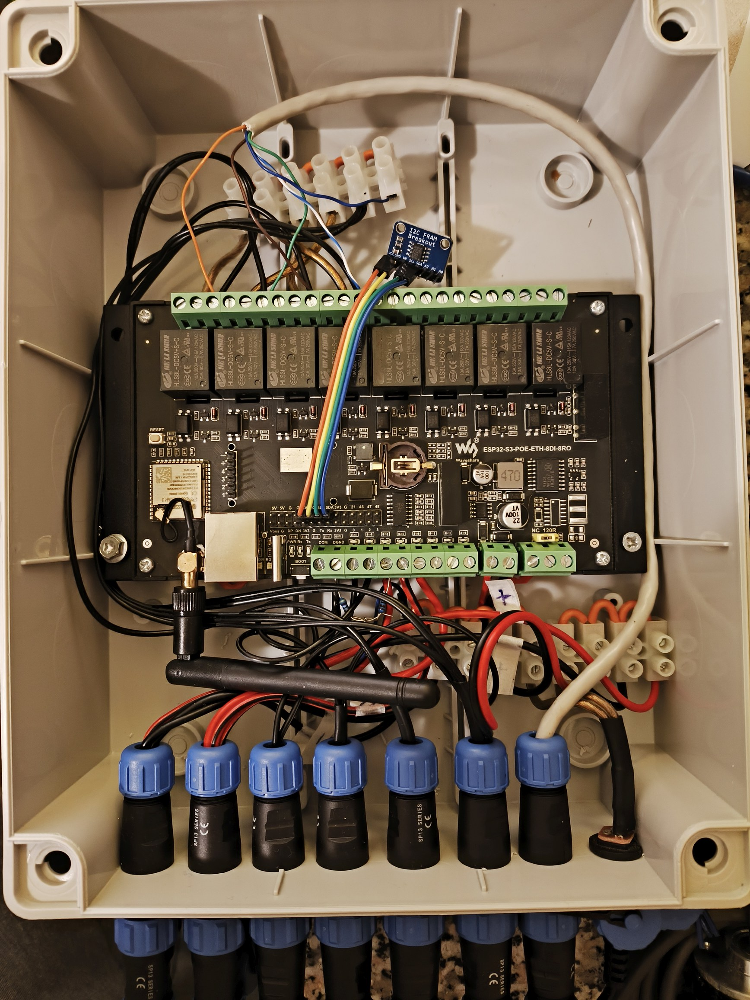
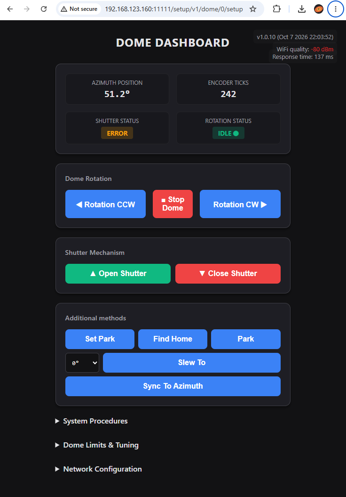

# ESP32-S3 Observatory Dome Controller

Firmware for a DIY observatory dome controller built on the **Waveshare ESP32-S3-ETH-8DI-8RO-C** board. It rotates the dome, opens and closes the shutter, finds home, parks, and exposes everything as an **ASCOM Alpaca** `Dome` device (IDomeV3), so it works with NINA and other Alpaca-capable astronomy software. A built-in web dashboard and a Bluetooth LE backup control path are included.

It is intended as a **drop-in replacement for the ScopeDome 1.1 controller card**: the same dome wiring is handled by this board (home sensor and rotation encoder are different), with the dome exposed to your software over WiFi through Alpaca.

> This is an independent community project and is not affiliated with or endorsed by ScopeDome. "ScopeDome" is used only to describe compatibility.

> **Firmware version:** v1.0.10 (set by `FIRMWARE_VERSION` in the sketch)  
> **License:** GPL-3.0-or-later

## Features

- **ASCOM Alpaca Dome (interface v3)** on port 11111 with UDP auto-discovery (port 32227)
- **Azimuth control** with a hardware quadrature encoder (ESP32 PCNT peripheral) and shortest-path slewing
- **Shutter control** (open / close) with limit switches, travel timeout and an error state
- **Home sensor** with automatic encoder re-sync every time it is passed
- **Park** position, settable from the current azimuth
- **Automatic calibration** of ticks per revolution and measurement of dome inertia, with inertia pre-cut for accurate stops
- **Non-volatile storage in I2C FRAM**: position is saved every second, so a power cut does not lose the azimuth
- **Web dashboard** for control, configuration, live log, WiFi setup and firmware upload
- **WiFi (DHCP)** with an open setup access point fallback and mDNS (`domecontroller.local`)
- **Bluetooth LE** service for WiFi provisioning and emergency dome control
- **OTA firmware update** through the dashboard
- **Safety systems**: soft tick limits, motor stall detection, operation timeouts, communication watchdog that closes the shutter, and motor stop on disconnect

## Hardware

| Part | Details |
|---|---|
| Board | Waveshare ESP32-S3-ETH-8DI-8RO-C (8 opto-isolated inputs, 8 relays via TCA9554 I2C expander) |
| Rotation drive | Two relays select clockwise / counter-clockwise (Relay 1 / Relay 2) |
| Shutter drive | Two relays for open / close, e.g. via inverter or motor controller (Relay 3 / Relay 4) |
| Encoder | Omron E6B2-CWZ6C, 2-channel quadrature (A and B) |
| Home sensor | Inductive sensor on DI3 |
| Shutter limits | Open and closed limit switches on DI1 / DI2 |
| FRAM | MB85RC-style I2C FRAM at address `0x50` (16-bit addressing), sharing the I2C bus with the relay expander |
| Ethernet | The onboard W5500 is **not used**. WiFi only. At boot its CS pin is held high and its SPI pins are left floating to keep it idle |



### Pin and channel mapping

| Function | Pin / channel |
|---|---|
| Shutter open limit switch | DI1, GPIO 4 |
| Shutter closed limit switch | DI2, GPIO 5 |
| Home sensor | DI3, GPIO 6 |
| Encoder A | DI4, GPIO 7 |
| Encoder B | DI5, GPIO 8 |
| I2C SDA / SCL | GPIO 42 / GPIO 41 |
| Relay expander (TCA9554) | I2C `0x20` |
| FRAM | I2C `0x50` |

| Relay | Function |
|---|---|
| Relay 1 | Rotate clockwise |
| Relay 2 | Rotate counter-clockwise |
| Relay 3 | Shutter open |
| Relay 4 | Shutter close |


Inputs are read with internal pull-ups and treated as **active when the GPIO reads LOW** (the board's opto stage inverts the field signal). If your sensors behave the opposite way, adjust `updateHomeSensor()` and `updateShutterSensors()`.

The encoder is counted in 1x mode: ticks increment on the rising edge of A, with the level of B setting the direction. A 500 ns glitch filter is applied.

> ⚠️ **Safety:** The rotation and shutter relays switch motors or mains-powered equipment. Use proper contactors, fuses and interlocks, and fit **hardware end-stops independent of this firmware**. The firmware inserts a 100 ms break between reversing relays, but it is not a substitute for electrical protection.

## Building and flashing

The project is a single Arduino sketch: `Observatory_controller.ino`.

### Requirements

- Arduino IDE (or arduino-cli) with the **ESP32 Arduino core 3.x** (needed for the `driver/pulse_cnt.h` PCNT API)
- Board: an **ESP32-S3** target (e.g. *ESP32S3 Dev Module*) with flash size matching your board and a **partition scheme that includes OTA**
- Library: **ArduinoJson 7.x** (install from the Library Manager)
- All other libraries (`WiFi`, `ESPmDNS`, `Preferences`, `Update`, `BLE*`, `Wire`) ship with the ESP32 core

### Steps

1. Open `Observatory_controller.ino`.
2. Select the ESP32-S3 board and the correct serial port.
3. Compile and upload.
4. Open the serial monitor at **115200 baud** to watch the boot log.

Later updates can be uploaded as a compiled `.bin` through the dashboard (see [OTA updates](#ota-firmware-updates)).

## First-time setup

### 1. Connect to WiFi

On first boot (no saved credentials), or if the saved network cannot be joined within 20 seconds, the controller starts an **open setup access point** named `DomeController-Setup`.

1. Join `DomeController-Setup` with a phone or laptop.
2. Browse to `http://domecontroller.local/` or `http://192.168.4.1/`.
3. Open **Network Configuration** on the dashboard, enter your SSID and password, and save. The controller reboots and joins your network.

Alternatively, provision WiFi over Bluetooth without leaving your normal network (see [Bluetooth LE](#bluetooth-le)).

Once on your network, the dashboard is at `http://domecontroller.local/` (port 80 redirects to the dashboard on port 11111). The IP address is also printed to the serial log.

### 2. Calibrate

Until calibrated, the controller reports `ticksPerRot = 1`.

1. Open the dashboard and expand **System Procedures**.
2. Click **Run Full Azimuth Calibration**.

The routine, driven non-blocking from the main loop:

1. Rotates CCW until the home sensor triggers and zeros the encoder.
2. Measures **inertia** (ticks the dome coasts after the motor stops).
3. Rotates CW out of the home zone.
4. Continues CW until home triggers again, and stores the tick count of one full revolution as `ticksPerRot`.

Each phase has a 120 s timeout. On any error nothing is saved. Results are stored in FRAM.

### 3. Set limits, park and timeouts

Under **Dome Limits & Tuning** you can set:

| Setting | Meaning |
|---|---|
| Encoder ticks limit low / high | Soft travel limits for cable-wrapped domes. `0` and `0` disables them |
| Park azimuth (°) | Where `Park` sends the dome. Also settable from the current position with **Set Park** |
| Encoder ticks per rotation | Set by calibration, editable manually |
| Dome inertia ticks | Set by calibration, editable manually |
| Shutter travel timeout (s) | 5 to 600, default 60 |
| Communication watchdog (min) | 0 to 1440, default 10, `0` = off |

## Using the controller

### ASCOM Alpaca

The controller advertises itself via Alpaca discovery and serves `Dome` device number 0.

- Discovery: UDP port `32227`, replies `{"AlpacaPort":11111}`
- API base: `http://<host>:11111/api/v1/dome/0/`
- Management: `/management/apiversions`, `/management/v1/description`, `/management/v1/configureddevices`
- Setup page: `/setup/v1/dome/0/setup` (the dashboard)

In NINA, choose **ASCOM Alpaca Dome** in Equipment and pick the discovered device.

Implemented IDomeV3 members:

| Type | Members |
|---|---|
| Properties | `azimuth`, `shutterstatus`, `slewing`, `athome`, `atpark`, `slaved`, `devicestate`, `connected`, `connecting`, `canfindhome`, `canpark`, `cansetaltitude`, `cansetazimuth`, `cansetpark`, `cansetshutter`, `canslave`, `cansyncazimuth`, `name`, `description`, `driverinfo`, `driverversion`, `interfaceversion`, `supportedactions` |
| Methods | `connect`, `disconnect`, `slewtoazimuth`, `synctoazimuth`, `abortslew`, `findhome`, `park`, `setpark`, `openshutter`, `closeshutter` |
| Not supported | Altitude, slaving, `commandblind` / `commandbool` / `commandstring` (return `NotImplemented`) |

Per the Alpaca spec, all requests except identity and connection routes return error `0x407` (not connected) until a client has connected. Dashboard requests are exempt.

Shutter status uses the ASCOM codes: 0 open, 1 closed, 2 opening, 3 closing, 4 error.

### Custom actions

`POST` or `PUT /api/v1/dome/0/action` with form field `Action=<name>`:

| Action | Description |
|---|---|
| `cw` / `ccw` | Start manual rotation (blocked by tick limits) |
| `stop` | Stop rotation |
| `open` / `close` | Open or close the shutter |
| `calibrate` | Run the calibration routine |
| `status` | JSON with shutter state, slewing, ticks, azimuth, RSSI |
| `getconfig` / `setconfig` | Read or write the persistent settings |
| `getlog` | Return the last 15 log lines |

### Other HTTP endpoints

| Method | Endpoint | Description |
|---|---|---|
| POST | `/api/v1/network/config` | Set WiFi `ssid` and `password`, then reboot |
| PUT | `/api/v1/system/reboot` | Save state and reboot |
| POST | `/api/v1/firmware/upload` | Stream a firmware `.bin` as the raw request body |

### Web dashboard

The dashboard shows azimuth, encoder ticks, shutter and rotation status, WiFi signal quality and response time. It provides manual rotation, stop, shutter buttons, Find Home, Park, Set Park, Slew To and Sync To, calibration, reboot, firmware upload, a live console, and the configuration panels.




### Bluetooth LE

The controller always advertises as **`DomeController`**, so you can configure or stop the dome with any BLE explorer app (nRF Connect, LightBlue) even when WiFi is down.

| Characteristic | UUID | Access | Payload |
|---|---|---|---|
| Service | `8e6a0001-9d34-4f77-8f2e-2d9c9a6d1a10` | | |
| Config | `8e6a0002-...` | Write | `{"ssid":"MyNetwork","password":"secret"}` (reboots on success) |
| Status | `8e6a0003-...` | Read / Notify | JSON with IP, SSID, AP-fallback flag, and command results |
| Control | `8e6a0004-...` | Write | `{"cmd":"stop"}`, `park`, `findhome`, `openshutter`, `closeshutter` |

(All UUIDs share the suffix `-9d34-4f77-8f2e-2d9c9a6d1a10`.)

### Serial commands

At 115200 baud:

- `STATUS` prints ticks, slewing state and shutter state
- `SETTICKS=<n>` forces the logical encoder position (bench testing)

## Safety behaviour

| Mechanism | Behaviour |
|---|---|
| Soft tick limits | Motor stops at the configured low/high encoder limits, and slews pick a path that stays inside them |
| Stall detection | If the motor is on and the encoder does not move for 5 s, the dome is stopped |
| Operation timeouts | Slew, park and homing each stop after 120 s |
| Shutter timeout | Motor stops and state becomes ERROR after the configured travel time |
| Shutter error state | Set when neither limit switch is active and the motor is idle |
| Communication watchdog | If no client uses the dome API for the configured time, the shutter is closed (once per silence period). Dashboard polling does not count |
| Disconnect | Disconnecting the Alpaca client stops the dome motors |
| Relay interlock | 100 ms pause when reversing direction |

## Persistent storage

Settings and position live in the FRAM, each record protected by a magic number and CRC32:

| Address | Record | Contents |
|---|---|---|
| `0x0000` | Config | ticks per rotation, tick limits, inertia, park azimuth |
| `0x0080` | Extra | watchdog minutes, shutter timeout |
| `0x0100` / `0x0120` | State (ping-pong) | azimuth ticks, shutter state, sequence number |

State is written every second when it changes, alternating between two slots so a power cut mid-write never loses the last valid position. Blank or corrupt records are reset to defaults at boot. WiFi credentials are stored separately in ESP32 NVS (`network-config`).

Set `DIAGNOSTIC_DISABLE_NVS_WRITES` to `1` in the sketch to disable all FRAM/NVS writes while debugging.

## OTA firmware updates

1. Export a compiled binary from the Arduino IDE (*Sketch → Export Compiled Binary*).
2. In the dashboard, open **System Procedures → Firmware Update**, choose the `.bin`, and click **Upload Firmware**.
3. The controller flashes the image and reboots automatically.

You can also upload with `curl`:

```bash
curl -X POST --data-binary @Observatory_controller.ino.bin \
  http://domecontroller.local:11111/api/v1/firmware/upload
```

## Security notes

This firmware is designed for a trusted observatory LAN:

- The Alpaca API, dashboard, OTA upload and BLE control have **no authentication**
- The setup access point is **open** (no password)
- Anyone in BLE range can send dome commands

Do not expose port 11111 to the internet, and consider the physical location of the dome when deciding whether this is acceptable.

## Troubleshooting

| Symptom | Likely cause |
|---|---|
| Can't find the controller | Join `DomeController-Setup` and use `http://192.168.4.1/`, or check the serial log for the DHCP address |
| `domecontroller.local` does not resolve | mDNS blocked on your network or OS; use the IP address |
| Alpaca calls return `0x407` | The client has not connected yet |
| Azimuth is wrong after power-up | Run **Find Home** so the encoder re-syncs to the home sensor |
| Dome stops moving unexpectedly | Stall detection (encoder not moving) or a tick limit was reached; check the log |
| Shutter state shows ERROR | Neither limit switch is active; check switch wiring or the travel timeout |
| "FRAM not found" in the log | Check the FRAM wiring and I2C address `0x50`; settings will not persist without it |
| Slewing overshoots | Re-run calibration to re-measure inertia |

## Project structure

```
.
├── Observatory_controller.ino   # Entire firmware, including the embedded web dashboard
└── README.md
```

## Contributing

Issues and pull requests are welcome.

## License

Copyright (C) 2026 Jurij Stare

This program is free software: you can redistribute it and/or modify it under the terms of the GNU General Public License as published by the Free Software Foundation, either version 3 of the License, or (at your option) any later version.

This program is distributed in the hope that it will be useful, but **WITHOUT ANY WARRANTY**; without even the implied warranty of merchantability or fitness for a particular purpose. See the [GNU General Public License](https://www.gnu.org/licenses/gpl-3.0.html) for more details. See the `LICENSE` file for the full text.

This firmware controls motors and mains-powered equipment. You use it entirely at your own risk.
